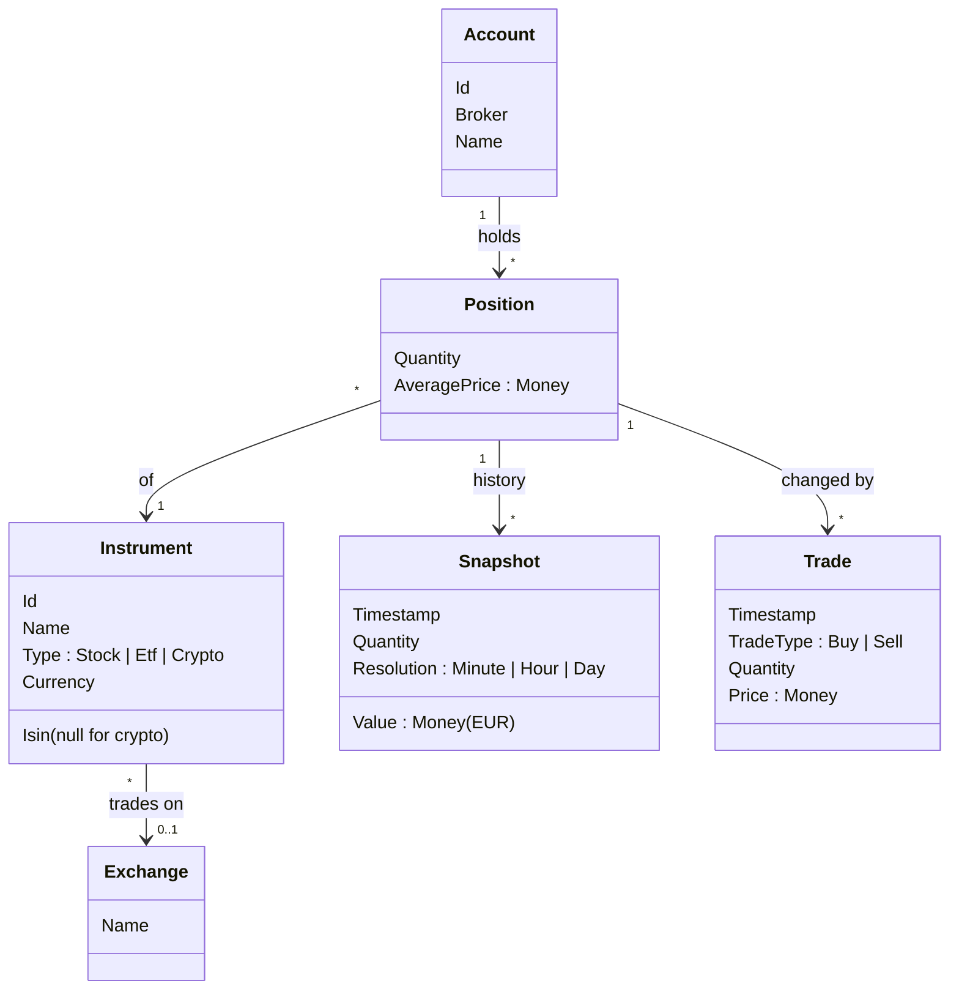

# Domain model

The core concepts of Ledgerly and how they relate. Names here are the project's shared vocabulary: code, docs and conversations use these words and no synonyms.

## Concepts

- **Account**: one connection to one broker, e.g. "my Trading 212 account". `Broker` is the kind (Trading 212 or Kraken); the account is the specific instance. UC03 adds an Account; FR02 says the same broker account cannot be added twice.
- **Instrument**: the tradable thing, the same for every investor (NVIDIA, SXR8, Bitcoin). It exists whether or not it is held.
- **Position**: the user's ownership of one Instrument in one Account: how much, and at what average price.
- **Exchange**: where an Instrument trades, e.g. XETRA or NASDAQ. Stocks and ETFs always have one; crypto has none, since it is not listed on a single venue and trades 24/7.
- **Snapshot**: the value of one Position at one moment, in EUR (FR04). Recorded every minute while running, filled hourly or daily for gaps (FR05), with `Resolution` saying which.
- **Trade**: one executed buy or sell that changed a Position's quantity (from Trading 212's filled orders and Kraken's trade history). Used to know the correct quantity at any moment inside a gap.
- **Money**: an amount together with its currency. Amounts are never stored or passed around without their currency.

## Decisions

- **"Asset" is not used.** In everyday speech it means both an Instrument and a Position; the model keeps them apart.
- **Portfolio is not stored.** It is all Positions across all Accounts, and its value at any moment is the sum of their Snapshots. Storing it separately would duplicate data that can go out of sync.
- **Stock, ETF and crypto are a `Type`, not separate classes.** They hold the same data; where behaviour differs (crypto has no exchange hours), a check on `Type` is enough. Inheritance would add classes without removing any code.
- **Prices and exchange rates are not stored.** They are inputs used to calculate a Snapshot's EUR value, then discarded. The incremental fetch (ADR-0002) uses the newest Snapshot's timestamp to know what is missing.
- **Instrument has its own `Id`; ISIN is an attribute.** Crypto has no ISIN, so ISIN cannot be the identity.
- **Exchange is a value, not an entity.** Two Exchanges with the same name are the same exchange, so it is a record with value equality and no `Id`.
- **The broker is not an Exchange.** Kraken is where the user holds crypto, which the model already expresses as an Account. Making it crypto's Exchange would mix the two concepts just to avoid a null.
- **Trading schedules are deferred.** Trading 212 attaches a schedule to each instrument, not to each exchange, and one exchange can have several. Where Schedule lives is decided when gap-filling (FR05) first needs it.
- **A Position at quantity 0 is closed, not deleted.** Its Snapshots and Trades still describe the portfolio's past, so removing the Position would erase that history.
- **An average price of 0 is valid.** Crypto received from staking rewards or airdrops costs nothing, so a Position made only of it has a zero average price. Negative values are rejected.
- **A Position's average price is in its Instrument's currency.** Prices are kept as the broker reports them; conversion to EUR happens only when a Snapshot is calculated.
- **Trade timestamps are stored in UTC.** Brokers and exchanges report times in different zones; converting on creation keeps every moment exact and comparable. The original time zone is dropped, since only the moment matters.
- **External identifiers are not in the domain model.** Trading 212 tickers, Kraken pair names and EODHD symbols belong to their adapters (ADR-0001); the core knows only the Instrument.
- **API keys are not part of the model.** They live in configuration (user secrets), never in the database (NFR02).

- **Quantities inside a gap are rebuilt from Trades, working backwards.** Filling a gap with the current quantity would be wrong before any trade made while Ledgerly was off. Instead, the quantity at a past moment is the current quantity minus buys plus sells made since then, so only the Trades inside the gap are fetched.

## Out of scope (for now)

- **Cash.** Uninvested cash held at the brokers is not part of portfolio value.
